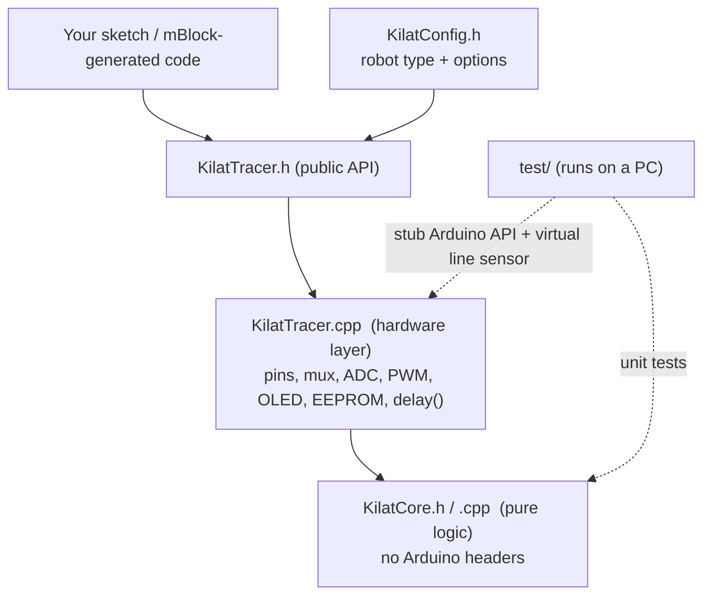
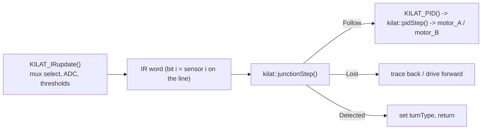
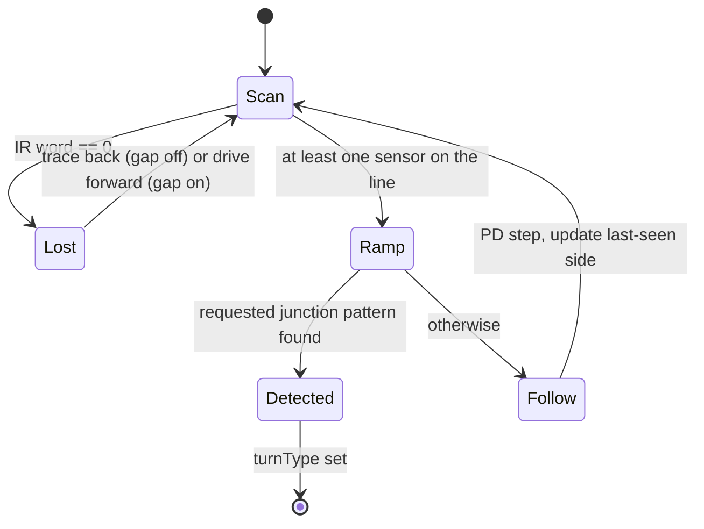

# Architecture

## Layers

* **Core** (`KilatCore.*`): functions of their arguments only. No pins, no
  timers, no `millis()`; time is passed in. This is what makes it testable.
* **Hardware layer** (`KilatTracer.cpp`): reads the multiplexer and ADC, writes
  PWM and LEDs, calls the core to decide, then acts. It keeps no decision logic
  of its own.
* **Configuration**: the robot type is a compile-time choice (`KilatConfig.h`
  or a build flag). Each robot is one `kilat::Profile` (a struct of numbers),
  so adding a robot does not touch the algorithms.

## One control cycle (`junction()`)

## Junction state machine

* `Y`, `T`, `L`, `R`: end when the pattern is seen (`turnType` 2 for Y; the
  profile's `turnT` / `turnSide` otherwise).
* `S` (skip): ends after `skipDuration` ms with `turnType = 1`. A negative
  duration never ends.
* Speed ramps from the start speed to the target at `spdUpStep` every
  `spdUpMs` and never overshoots the target.

## Conventions

* Sensor index 0 is the **right** side; the highest index is the **left** side.
* `computeError()` is 0 when centred, **positive** when the line is on the right
  (low indices), **negative** on the left, 100 units per sensor step.
* Motor A is the left motor and motor B the right motor.
* `last_IR`: `0b10` = line last seen on the left, `0b01` = on the right.

## Design decisions

1. **Extract, do not rewrite.** The logic was moved out of the hardware code
   unchanged, then pinned down with tests written from the original behaviour.
   The few intentional changes are listed in the changelog.
2. **No dynamic memory, no `String`.** Everything is fixed-size, which suits a
   2 KB-RAM microcontroller.
3. **Compile-time robot selection.** Unused robots cost no flash or RAM. The
   core takes the profile as an argument, so one test binary covers all robots.
4. **Test seams, not mocks of everything.** The only seam in the hardware layer
   is the Arduino API itself (stubbed in `test/stubs/`); `KILAT_muxSelectByte()`
   lets a test map ADC reads back to logical sensors.
5. **Differential test against the original.** `test/golden/legacy` keeps the
   pre-refactor firmware; `make diff` requires identical output traces for random
   scenarios. Two intentional differences are kept out of the scenarios: the
   HammerHead_11 speed-ramp overshoot for odd-parity targets above 150, and
   calibration thresholds that would overflow a byte (both are fixes, see the
   changelog).
6. **What is not tested.** Timing on the real ADC, motor behaviour, sensor
   noise and the OLED are not covered; see [KNOWN_ISSUES.md](KNOWN_ISSUES.md).
